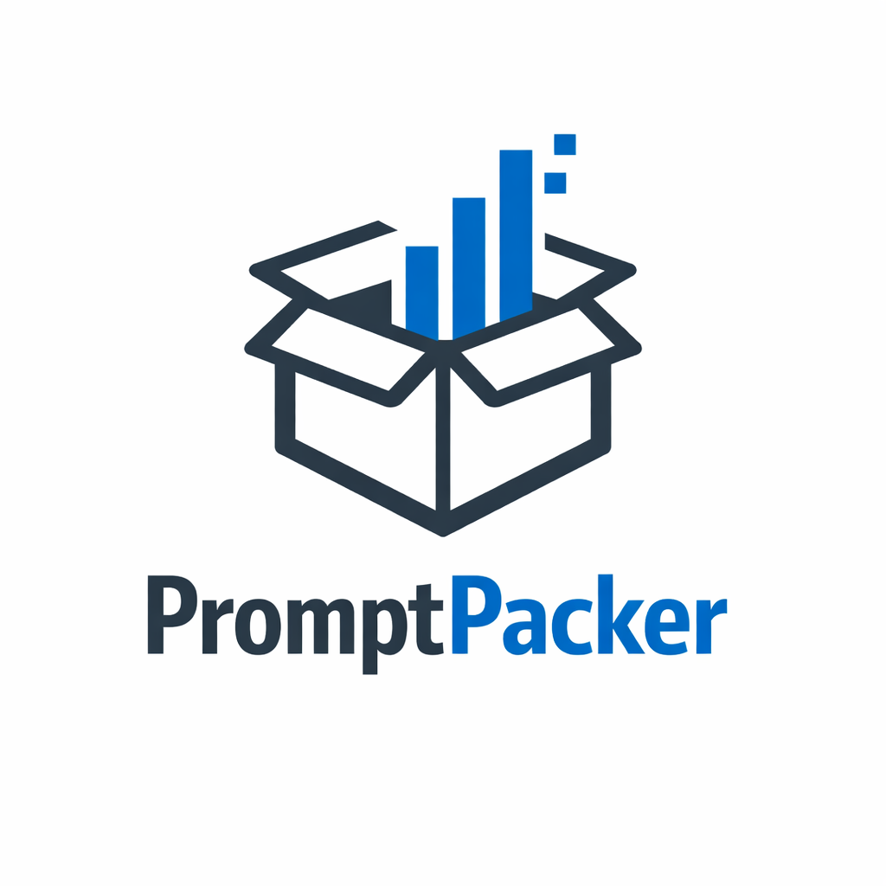

# PromptPacker

<p align="center">
  
</p>

<p align="center">
  <strong>Stop pasting code. Start Packing.</strong>
</p>

<p align="center">
  <a href="#agent-terminal-for-google-colab">Colab Agent</a> •
  <a href="#-quick-start">Quick Start</a> •
  <a href="#-why-promptpacker">Why?</a> •
  <a href="#-features">Features</a> •
  <a href="https://prompt-packer-one.vercel.app/">Website</a>
</p>

<p align="center">
  <a href="https://github.com/ClarkOhlenbusch/PromptPacker/releases">
    
  </a>
  <a href="LICENSE">
    
  </a>
</p>

---

## Agent Terminal for Google Colab

Work with a coding agent inside your Colab notebook. PromptPack opens a terminal in Colab and connects it to an agent running on your computer through **PromptPack Bridge**. You can ask the agent to edit existing cells, add cells, move or delete them, and request a run. Saved edits sync to your notebook; your agent’s normal approval settings apply.

### What you need

- A Chrome browser, an editable Colab notebook, and the [PromptPack Colab extension preview](https://github.com/ClarkOhlenbusch/PromptPacker/raw/refs/heads/main/PromptPackerColab-chrome.zip). The [Chrome Web Store listing](https://chromewebstore.google.com/detail/piniclchmidgfainpldphnocipgilmll) is available for the published extension; use the preview build for the latest Agent Terminal changes.
- **PromptPack Bridge**, a small companion app that runs on your computer. [Find Bridge downloads](https://github.com/ClarkOhlenbusch/PromptPacker/releases?q=bridge-v&expanded=true). If no Bridge release is listed yet, see the [Bridge guide](promptpack-bridge/README.md) to build a development preview.
- An installed and signed-in coding agent, such as Codex or Claude Code. Bridge offers links to their setup instructions. Custom command-line agents can also be configured.

### Start a session

1. Unzip the extension preview. In Chrome, open `chrome://extensions`, turn on **Developer mode**, choose **Load unpacked**, and select the unzipped folder containing `manifest.json`.
2. Install and open PromptPack Bridge. Leave it running until it says **Ready for Colab**.
3. Open an editable notebook in [Google Colab](https://colab.research.google.com/), open PromptPack, and select **Agent Terminal**.
4. Choose your agent, click **Start session**, and sign in if the agent asks. Describe what you want in the terminal.

Bridge connects locally to the extension and keeps a temporary copy of the notebook cells for your agent. Colab and your coding agent operate under their own accounts, permissions, and service settings. Execution may require a connected Colab runtime; a queued run does not by itself confirm that code completed. Cell type conversion is not currently supported.

The [Bridge guide](promptpack-bridge/README.md) has platform setup and troubleshooting details. The regular prompt-packing features do not require Bridge.

---

## 🚀 Quick Start

### PromptPack Lite desktop

Download the desktop app for your computer from [GitHub Releases](https://github.com/ClarkOhlenbusch/PromptPacker/releases) or visit [prompt-packer-one.vercel.app](https://prompt-packer-one.vercel.app/) for download options. PromptPack Lite and PromptPack Bridge are separate apps.

---

## 🤔 Why PromptPacker?

You know that thing where you copy-paste 47 files into ChatGPT and hope it understands your codebase?

Yeah, we fixed that.

**PromptPacker** is a context engineering toolkit that intelligently selects, compresses, and formats your code for LLMs. It understands *structure*, not just text.

### The Problem

- Most files you paste are noise (node_modules, build artifacts, images)
- Full file contents waste tokens on implementation details
- You lose track of what you already shared
- Browser-based AI tools have no concept of "your project"

### The Solution

- **Smart Scanning** — Respects `.gitignore`, skips binaries automatically
- **AST Skeletonization** — 70% fewer tokens, same structural understanding
- **Context Tiers** — Full code, skeleton, or omit entirely
- **Auto-Watch** — Your context stays current as you code

---

## ✨ Features

### 🖥️ PromptPack Lite (Desktop App)

A native desktop app that runs **100% locally**. No cloud, no tracking.

| Feature | Description |
|---------|-------------|
| **Local File Scanning** | Recursively scans directories, respects `.gitignore` |
| **AST Skeletonization** | Tree-sitter powered structural summaries — imports, types, signatures |
| **Auto-Watch** | Detects file changes, refreshes automatically |
| **Context Tiers** | Full → Skeleton → Omit |
| **Smart Preamble** | Auto-generates context from `package.json`, `README.md`, config files |

**Tech Stack:** Rust (Tauri v2), React 19, TypeScript, Tailwind CSS

---

### 🧩 PromptPack Colab (Browser Extension)

Bring PromptPacker into your Google Colab workflow.

| Feature | Description |
|---------|-------------|
| **Agent Terminal** | Connect a local coding agent to your open notebook through Bridge |
| **Notebook Editing** | Sync cell edits and add, move, or delete cells |
| **Notebook Context** | Treats Colab cells as files for prompt packing |
| **Diff Tracking** | See what changed since your last snapshot |
| **Visual Diffs** | Side-by-side before packing |
| **Quick Copy** | Global hotkeys to grab entire notebook context |

**Tech Stack:** React 19, Vite, Chrome Manifest V3

---

### 🌐 PromptPack Site

Marketing site with auto-updating downloads from GitHub Releases.

**Live at:** [prompt-packer-one.vercel.app](https://prompt-packer-one.vercel.app/)

---

## 📸 Screenshots

<p align="center">
  <i>Screenshots coming soon — see <a href="https://prompt-packer-one.vercel.app/">prompt-packer-one.vercel.app</a> for live demo</i>
</p>

---

## 🏗️ Architecture

PromptPacker uses **Hexagonal Architecture** to share UI logic between Desktop and Extension:

```
┌─────────────────┐     ┌─────────────────┐
│   Desktop App   │     │   Extension     │
│   (Tauri/Rust)  │     │   (Chrome API)  │
└────────┬────────┘     └────────┬────────┘
         │                       │
         └───────────┬───────────┘
                     │
         ┌───────────▼───────────┐
         │  FileSystem Interface │  ← Shared abstraction
         │  (scan, read, watch)  │
         └───────────┬───────────┘
                     │
         ┌───────────▼───────────┐
         │      Core Logic       │
         │   (React + TS)        │
         └───────────────────────┘
```

---

## 🔮 Roadmap

- [x] Desktop app (macOS)
- [x] Browser extension (Colab)
- [x] Landing page
- [x] Windows & Linux builds
- [ ] **PromptPack Heavy** — Local SLM for semantic code summarization
- [ ] VS Code extension
- [ ] JetBrains plugin

---

## 🛠️ Development

### Prerequisites

- Node.js (v18+)
- Rust (latest stable) — for Desktop App

### Desktop App

```bash
cd prompt-pack-lite
npm install
npm run tauri dev      # Development
npm run tauri build    # Production build
```

### Browser Extension

```bash
cd ColabPromptPack
npm install
npm run build
# Load 'dist' folder as unpacked extension in Chrome
```

### Landing Page

```bash
cd prompt-pack-site
npm install
npm run dev
```

---

## 📄 License

Apache License 2.0 — see [LICENSE](./LICENSE)

---

## 🙏 Acknowledgments

Built with:
- [Tauri](https://tauri.app) — Rust-based desktop framework
- [Tree-sitter](https://tree-sitter.github.io/tree-sitter/) — Parsing wizardry
- [React](https://react.dev) — UI that doesn't fight you

---

<p align="center">
  <strong>Made with ☕ and 🦀</strong>
</p>

<p align="center">
  <a href="https://github.com/ClarkOhlenbusch">@ClarkOhlenbusch</a>
</p>
